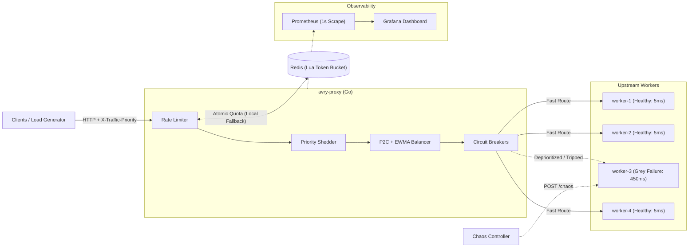
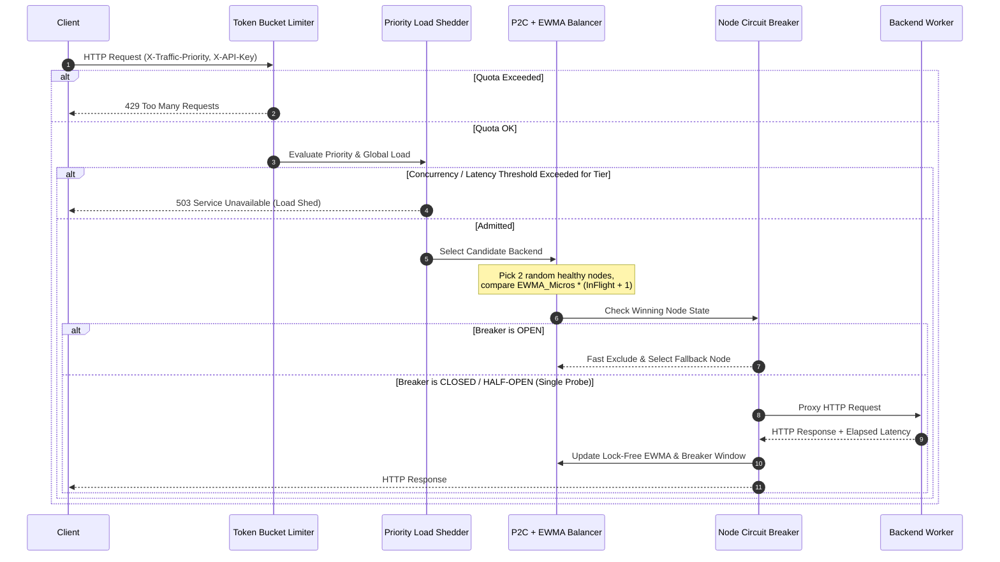

# avry-proxy — Adaptive L7 Resilience Proxy & Chaos Testbed

`avry-proxy` is a high-concurrency L7 HTTP reverse proxy and chaos testing harness written in Go. It is engineered around Google SRE principles (*Handling Overload*, *Addressing Cascading Failures*, and *Tail at Scale*) to isolate grey failures, prevent connection-pool exhaustion, and protect critical traffic SLOs under asymmetric upstream degradation.

---

## Grey Failure Benchmark Results (Asymmetric Node Degradation)

**Workload Configuration:**
- **Cluster Topology:** 4 upstream workers (`5ms` baseline latency) behind `avry-proxy`
- **Fault Injection:** At $t = 1\text{s}$, `worker-3` experiences a **grey failure** (`+450ms` latency spike + `20%` HTTP 500 error rate)
- **Target Load:** ~2,000 req/s (64 concurrent clients, mixed `critical` / `high` / `low` priorities)

| Metric | Baseline (`round-robin`) | `avry-proxy` (`p2c-ewma` + CB + Shedder) | Improvement |
| :--- | :---: | :---: | :---: |
| **p50 Latency** | 6.48 ms | **7.15 ms** | Steady ~5–7ms baseline |
| **p95 Latency** | 456.44 ms | **10.74 ms** | **97.6% reduction** |
| **p99 Tail Latency** | 457.24 ms | **11.58 ms** | **97.5% reduction** |
| **Traffic Routed to Degraded `worker-3`** | 25.2% (1,322 reqs) | **3.2% (499 reqs)** | Isolated automatically |
| **Upstream 5xx Error Rate** | 2.96% | **0.03%** | Fast-failed & rerouted |
| **Critical Priority SLO Survival** | 95.85% | **99.69%** | Protected |
| **Sustained Throughput** | 654 req/s | **1,979 req/s** | **3.0x higher** (no head-of-line blocking) |

> Reproduce these numbers anytime on your machine with `make bench` (or `./benchmarks/run_experiment.sh`).

---

## System Architecture



### Request Lifecycle & Resilience Pipeline

Every incoming HTTP request traverses a deterministic, lock-free pipeline:



---

## Core Design & Algorithms

### 1. Power of Two Choices (P2C) + Lock-Free EWMA Load Balancing (`internal/balancer/p2c_ewma.go`)
Pure Round-Robin routing suffers from severe tail-latency amplification when a single upstream node experiences a grey failure (such as GC pauses, noisy neighbors, or partial disk stalls). `avry-proxy` tracks each backend's **Exponentially Weighted Moving Average (EWMA)** latency in microseconds using lock-free `CompareAndSwap` loops:

$$\text{EWMA}_t = \alpha \cdot L_{\text{sample}} + (1 - \alpha) \cdot \text{EWMA}_{t-1} \quad (\alpha = 0.30)$$

When routing a request, P2C samples two distinct healthy backends $(b_i, b_j)$ uniformly at random and selects the node minimizing the composite load score:

$$\text{Score}(b) = \text{EWMA}_{\text{effective}}(b) \times \left(\text{InFlight}(b) + 1\right)$$

- **Fast-Failure Penalty Floor:** If a node returns an `HTTP 5xx` error or transport failure quickly (e.g., in `1ms`), a minimum penalty floor (`500ms`) is fed into the EWMA update so fast-failing nodes cannot trick the latency tracker into routing more traffic to them.
- **Idle Recovery Decay:** If an elevated node has been idle beyond the decay window (`2s`), its effective EWMA score decays exponentially toward the baseline so healed nodes automatically rejoin rotation without manual intervention.

### 2. Per-Node Circuit Breaker State Machine (`internal/resilience/circuitbreaker.go`)
Each upstream node is guarded by an independent circuit breaker state machine (`Closed` $\to$ `Open` $\to$ `Half-Open`):
- **`Closed`:** Tracks rolling window failure ratio and consecutive failures. Trips to `Open` when consecutive failures reach threshold (`8`) or the failure rate exceeds `50%` over at least `20` requests.
- **`Open`:** Immediately excludes the degraded backend during load-balancer selection and reroutes the request to a healthy peer with zero network wait.
- **`Half-Open`:** After `OpenCooldown` (`5s`) elapses, atomically admits **exactly one** probe request (`probeInFlight.CompareAndSwap(false, true)`). A successful probe resets the breaker to `Closed`; a failure re-opens the circuit immediately.

### 3. Priority-Aware Adaptive Load Shedding (`internal/resilience/shedder.go`)
Inspects `X-Traffic-Priority` (`critical`, `high`, `low`) and tracks both global in-flight concurrency and rolling proxy-wide EWMA latency:
- **`low` priority (batch/background):** Shed immediately with `HTTP 503` when global concurrency exceeds the low watermark (`75%` of `MaxConcurrency`) **or** when global EWMA latency spikes above `150ms`.
- **`high` priority (standard interactive):** Shed when global concurrency exceeds the high watermark (`90%`), reserving the final `10%` of capacity exclusively for `critical` SLO traffic.
- **`critical` priority:** Admitted up to `100%` of `MaxConcurrency`.

### 4. Distributed Redis Lua Token-Bucket Rate Limiter (`internal/resilience/ratelimiter.go`)
Enforces per-client rate limits (`X-API-Key`, `X-Forwarded-For`, or client IP) using an atomic Redis Lua script (`EVAL`) over a pooled RESP connection. If Redis is unconfigured, unreachable, or exceeds a strict `15ms` deadline, the limiter **fails open into a local in-memory token bucket** so an observability/cache dependency outage never causes a proxy outage.

---

## Repository Structure

```text
avry-proxy/
├── cmd/
│   ├── proxy/main.go                # Entrypoint for avry-proxy server
│   ├── worker/main.go               # Upstream worker with live /chaos injection API
│   └── bench/main.go                # Self-contained grey-failure chaos benchmark runner
├── internal/
│   ├── balancer/
│   │   ├── balancer.go              # Backend node state & Balancer interface
│   │   ├── roundrobin.go            # Baseline Round-Robin load balancer
│   │   └── p2c_ewma.go              # Power of Two Choices + lock-free EWMA balancer
│   ├── resilience/
│   │   ├── circuitbreaker.go        # Per-node circuit breaker state machine
│   │   ├── shedder.go               # Priority-aware adaptive load shedder
│   │   └── ratelimiter.go           # Redis Lua token bucket with local fallback
│   ├── proxy/
│   │   └── server.go                # ReverseProxy pipeline & fast-failover routing
│   └── telemetry/
│       └── prometheus.go            # Lock-free Prometheus metrics collector & exporter
├── deploy/
│   ├── docker-compose.yml           # Spins up proxy, 4 workers, Redis, Prometheus, Grafana
│   ├── prometheus.yml               # 1s scrape interval config
│   └── grafana/                     # Pre-provisioned Grafana datasource & dashboard JSON
├── benchmarks/
│   ├── run_experiment.sh            # Runs head-to-head chaos benchmark & saves Markdown/JSON
│   ├── load_test.js                 # k6 load script with mixed traffic priorities
│   └── results/                     # Saved benchmark comparison tables
├── Dockerfile                       # Multi-stage Alpine container build
└── Makefile                         # Build, test, and benchmark targets
```

---

## Quick Start & Usage

### 1. Run Unit & Race Detector Tests
```bash
make test
```

### 2. Run the Automated Grey-Failure Benchmark
```bash
make bench
```
This spins up a 4-worker cluster, injects a `+450ms` latency spike + `20%` error burst on `worker-3` at $t = 1\text{s}$, compares `--strategy=round-robin` against `--strategy=p2c-ewma` with full resilience enabled, and writes the report to `benchmarks/results/latest_benchmark.md`.

### 3. Launch the Full Docker + Prometheus + Grafana Stack
```bash
docker compose -f deploy/docker-compose.yml up --build -d
```
- **Proxy Endpoint:** `http://localhost:8080/work`
- **Proxy Health & Node Telemetry:** `http://localhost:8080/healthz`
- **Prometheus Metrics Exporter:** `http://localhost:8080/metrics`
- **Prometheus UI:** `http://localhost:9090`
- **Grafana Dashboard:** `http://localhost:3000` (`admin` / `admin`)

### 4. Inject Live Chaos into Upstream Workers
While traffic is flowing, inject a grey failure into `worker-3` without restarting containers:
```bash
curl -X POST http://localhost:8083/chaos \
  -H "Content-Type: application/json" \
  -d '{"added_latency_ms": 450, "jitter_ms": 25, "error_rate": 0.20, "error_status_code": 500}'
```

Inspect real-time EWMA latency and circuit breaker states on the proxy:
```bash
curl -s http://localhost:8080/healthz | jq .
```

Heal `worker-3` back to normal (`5ms` baseline):
```bash
curl -X POST http://localhost:8083/chaos \
  -H "Content-Type: application/json" \
  -d '{"added_latency_ms": 0, "jitter_ms": 0, "error_rate": 0.0}'
```

---

## Exposed Prometheus Metrics (`/metrics`)

| Metric Name | Type | Description |
| :--- | :---: | :--- |
| `avry_requests_total` | Counter | Total HTTP requests labeled by `backend`, `status`, `priority`, and `action` (`forwarded`, `shed`, `ratelimited`, `circuit_broken`) |
| `avry_request_duration_seconds` | Histogram | Upstream request latency distribution (`5ms` to `1s` buckets) per `backend` |
| `avry_backend_ewma_latency_ms` | Gauge | Real-time lock-free EWMA latency per `backend` in milliseconds |
| `avry_backend_inflight_requests` | Gauge | Active concurrent in-flight requests per `backend` |
| `avry_circuit_breaker_state` | Gauge | Circuit breaker state per `backend` (`0=closed`, `1=half-open`, `2=open`) |
| `avry_shedder_inflight_requests` | Gauge | Global active concurrency tracked by the priority load shedder |
