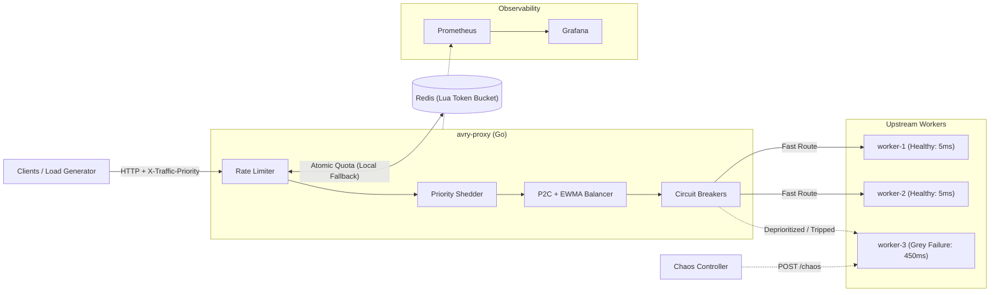

# avry-proxy

Adaptive L7 Resilience Proxy & Chaos Testbed written in Go.

## Overview

`avry-proxy` is a high-concurrency L7 HTTP reverse proxy engineered to mitigate grey failures, tail-latency amplification, and cascading overload across upstream clusters.

### Core Capabilities
- **Adaptive Load Balancing:** Power of Two Choices (P2C) weighted by lock-free Exponentially Weighted Moving Average (EWMA) latency and active in-flight concurrency, plus a baseline Round-Robin mode for A/B benchmarking.
- **Per-Node Circuit Breaking:** Rolling state machine (`Closed` -> `Open` -> `Half-Open`) isolating degraded upstreams before thread/connection pools saturate.
- **Distributed Token-Bucket Rate Limiting:** Redis-backed atomic Lua token bucket with automatic fail-open fallback to a local in-memory limiter if Redis becomes unavailable.
- **Priority-Aware Load Shedding:** Protects critical traffic SLOs (`X-Traffic-Priority: critical | high | low`) by shedding low-priority load when global concurrency or tail latency crosses thresholds.
- **Chaos Worker & Observability:** Upstream worker service with live `/chaos` fault injection (latency spikes, jitter, HTTP error bursts) and Prometheus/Grafana telemetry.

## System Architecture



## Quick Start

```bash
make test
make build
```
